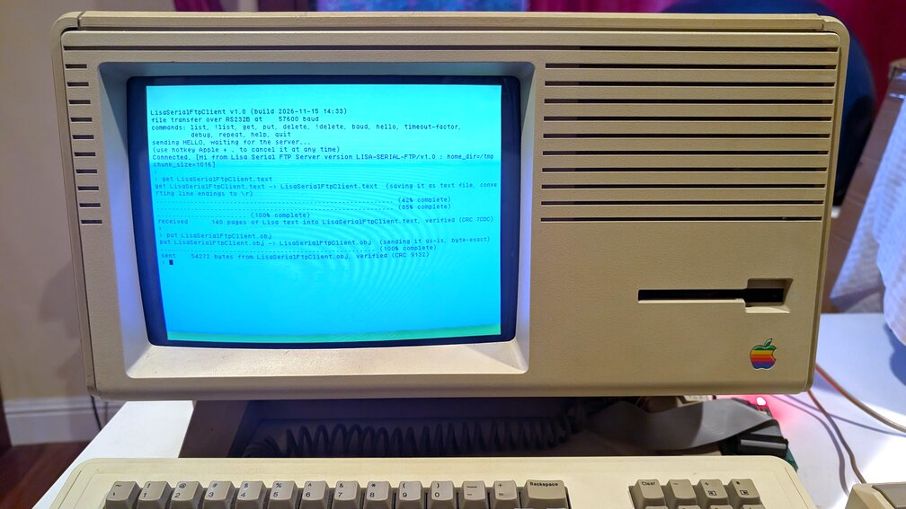
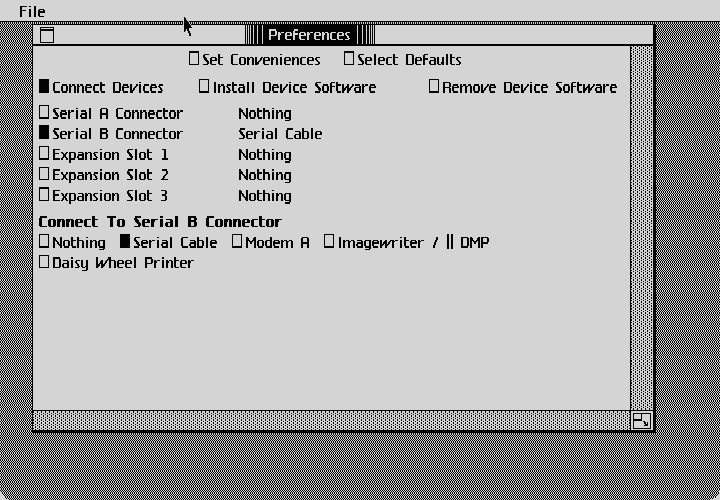
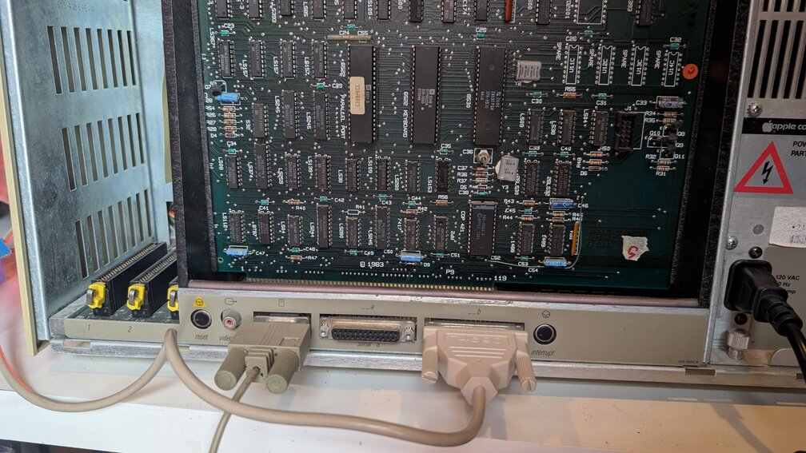
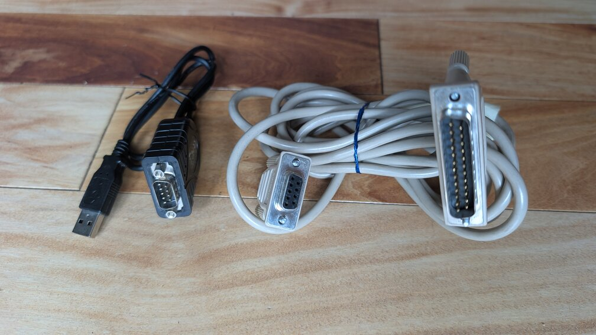
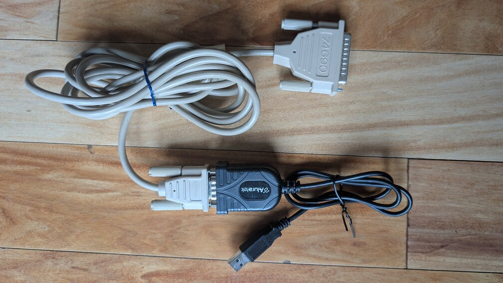

# Lisa Serial FTP — file transfer between an Apple Lisa and a modern computer over a serial cable

The client: a terminal-like Pascal-based program LisaSerialFtpClient.obj that runs in the Apple Lisa Workshop 3.0 development environment. All user interaction happens here. It supports downloading and uploading both text and binary files (note: the
Lisa OS stores them differently), listing and deleting files on both sides. It
transfers data in retryable chunks; every chunk is verified and, if needed,
retried; the whole file size, CRC16 checksum and byte sum is verified at the
end, and the file is accepted only then.

The server: a non-interactive Python-based LisaSerialFtpServer.py program that runs on your modern computer and listens for commands.

The tool is useful for developing applications for the Apple Lisa (both Lisa Office system and Workshop apps). Here is a typical development setup:
* Write source code (in Pascal, Assembler, Basic, etc) on your PC using your favorite editor.
* Keep the LisaSerialFtpServer.py server running on your PC (it auto-reconnects as needed, there is no need to restart it).
* Download your code onto your Lisa: go on your Lisa (either on a real Lisa or the LisaEm emulator running on the same PC), launch the LisaSerialFtpClient app in the Workshop development environment,
  and run one-or-more "get" commands to download your files.
* Compile, link and test your app on the Lisa.
* A powerful option: use a Workshop Macro like [this one](src/client/LisaSerialFtpClientMake.text)  on your Lisa to download, compile and link your code with just one command!




## Installing and running the client app in Lisa Workshop

Clone this repository to a folder on your PC.

### Get the `LisaSerialFtpClient.obj` executable into Workshop.

* Option 1: The DC42 floppy disk image file `LisaSerialFtpClient.dc42` contains the
executable file `LisaSerialFtpClient.obj`. Boot into Lisa Workshop, then insert ("mount") that
disk image, e.g. using a FloppyEmu or ESFloppy floppy disk hardware
emulator on a real Lisa, or in the LisaEm emulator, from the File -> Insert Diskette menu item.
Once in Workshop, you will have to copy it to your ProFile hard
drive, this way: Press `f` to get into the File Manager submenu, then press `c` for
"copy", then enter source filename `-UPPER-LisaSerialFtpClient.obj`, enter,
then the target filename `-LOWER-LisaSerialFtpClient.obj`, and follow the
prompts to complete the copying. Here we assume that you are using a Lisa 2/5
whose boot menu has the floppy disk above the hard disk (hence we use "UPPER"
in the source filename). On a Lisa 2/10 the boot menu looks different: your
floppy disk drive is named "LOWER", and the hard disk is "UPPER" in Workshop.
Press `q` to exit to the main Workshop menu.

* Option 2: Most people use a ProFile hardware emulator on their Lisa-s such as ESProfile (the most popular one) and others; the hard disk image files sit on an micro-SD card.
Plug the SD card in your PC, and use my "copy" tool at https://github.com/TorZidan/LisaFileSystemTool#12-lisafilesystemtoolperfilepy---adding-replacing-deleting-and-getting-files
to copy file [LisaSerialFtpClient.obj](./LisaSerialFtpClient.obj) onto your desired disk image, then move the mocroSD card back into the ProFile hardware emulator.

* Option 3: Just copy the
  [profile-5MB-LOSAndWorkshop3-UseWith88iorom.image](./profile-5MB-LOSAndWorkshop3-UseWith88iorom.image)
  to your SD card and boot it up into Workshop. It has a clean installation of
  Lisa Office System 3.1, Workshop 3.0 and the LisaSerialFtpClient.obj
  executable. As the file name says, it should be used with I/O Rom version 88
  (aka Lisa 2/10). Booting it up using any other I/O Rom version may result in
  a boot error.

Note: once you have `LisaSerialFtpClient.obj` on your ProFile hard drive, you can get newer versions of this tool (if any) by running this tool.

### Ensure Serial Port B is set to "Serial Cable" in the Workshop Preferences
In Workshop, press `s` for Sys-Manager submenu, then `p` to run the Preferences app.
In it: check the "Connect Devices" checkbox and make sure that "Serial B Connector"
is set to "Serial Cable, like so:



### Running the client app in Lisa Workshop

To run the app: in the main Workshop menu, press `r` (for "run"), then type the
program name `LisaSerialFtpClient` (there is no need to type the file
extension), enter. The program will start, it will attempt to connect to the
server, and will give you a `>` command prompt. Type `hello` and `help` to see what's there.

## Running the server on your PC

Requirements: **Python 3.5 or newer**.  On Linux and macOS nothing else is
needed: the server uses only Python's standard library.  On Windows it also
needs **pyserial** (`pip install pyserial`), because Windows has no `termios`.

The server shares one folder with the Lisa, the "home folder" given with
`--home_dir`: the Lisa can list, get, put and delete the files in it and in its
subfolders, and nothing outside it.  The folder must exist (the server does
not create it, so a mistyped path is an error rather than a new, empty share).

Run these commands from the folder where you cloned this repository:

### On Linux

```sh
mkdir -p ~/lisa-share
python3 src/server/LisaSerialFtpServer.py --port /dev/ttyUSB0 --home_dir ~/lisa-share
```

### On macOS

```sh
mkdir -p ~/lisa-share
python3 src/server/LisaSerialFtpServer.py --port /dev/cu.usbserial-1410 --home_dir ~/lisa-share
```

Use the `/dev/cu.*` name of the adapter, not its `/dev/tty.*` twin (opening that
one can wait for a carrier signal that never comes).

### On Windows

```
pip install pyserial
mkdir C:\lisa-share
python src\server\LisaSerialFtpServer.py --port COM3 --home_dir C:\lisa-share
```

The device name (`/dev/ttyUSB0`, `/dev/cu.usbserial-1410`, `COM3`) is that of
your USB serial adapter: see the FAQ
[How to find the device name of my USB serial dongle?](#how-to-find-the-device-name-of-my-usb-serial-dongle)
. If using the LisaEm emulator (instead of a real Apple Lisa computer), use its virtual port instead, e.g. `--port /tmp/lisaem-port-b`. Find detailed instructions
at [Setting up LisaEm for a 1st time](https://github.com/arcanebyte/lisaem/blob/master/LisaEmAsASoftwareDevelopmentEnvironment.md#setting-up-lisaem-for-a-1st-time).

`--port` can also be left out: it defaults to `--port auto`, which finds the
port itself.  If there is just one serial or PseudoTTY port, it uses
that one; if there are more, it lists them and chooses one this way: a symbolic link to a pty
(such as `/tmp/lisaem-port-b` (created by the LisaEm emulator) first, then the pty of a running LisaEm, then a USB adapter, then a
built-in serial port.  If there
is none yet, it waits for one.  Two narrower variants pick in the same way,
but only among some of the ports:

* `--port auto-pty`: discovers only PseudoTTYs ports, like the ones opened by LisaEm;
* `--port auto-serial`: discovers only the USB adapters and built-in serial ports, use with a
  a real Lisa.

For example, `--port auto` may show:

```
--port auto: ports found on this computer:
  PseudoTTY:  /tmp/b  (-> /dev/pts/0)
  PseudoTTY:  /dev/pts/0  (lisaem, pid 838896)
  USB serial: /dev/ttyUSB0  (USB-Serial Controller D)
--port auto: using /tmp/b (give --port to use another one)
```

When the server starts, it prints a line such as

```
LISA-SERIAL-FTP/v1.0 listening on /dev/ttyUSB0 at 57600 baud, home_dir=/home/me/lisa-share, debug output off
```

and then waits for the Lisa client.  Each command from the Lisa is printed as
it is served.

### Useful options

| Option | What it does |
|---|---|
| `--port DEVICE` | the serial port; default `auto`, also `auto-pty` and `auto-serial` (see above) |
| `--baud N` | the starting baud rate (default 57600); the client's `baud` command can change it later |
| `--debug` | print every protocol line and chunk (the client's `debug on/off` switches it too) |
| `--read-only` | refuse PUT and DELETE: the Lisa can only list and get |
| `--timeout S` | seconds to wait for a command or abort reply (default 15) |

`python3 src/server/LisaSerialFtpServer.py --help` lists them all.

### Stopping the server

The server runs until you stop it with Ctrl-C.

If the port is not there when it starts (LisaEm emulator not running yet, adapter not
plugged in), the server says so once and waits for it.  It also lists the
ports it can find, to help you pick the right `--port` name, and lists them
again when they change (e.g. when you plug the adapter in):

```
serial port /tmp/lisaem-port-b is not there (No such file or directory); waiting for it.  Ctrl-C to stop.
ports found on this computer:
  USB serial: /dev/ttyUSB0  (USB-Serial Controller D)
  PseudoTTY:  /dev/pts/0  (lisaem, pid 838896)
  PseudoTTY:  /tmp/b  (-> /dev/pts/0)
```

USB serial adapters are found on Linux, macOS and Windows; built-in serial
ports (`/dev/ttyS0`, ...) on Linux.  PseudoTTYs are the
pty of each running LisaEm (Linux only) and any link to a pty in `/tmp` or
`/dev`, whatever `--port` says.

If the port goes away
while it runs (the emulator quits, the adapter is unplugged), it says so once,
checks every second, and reopens the port by its path when it is back (a
virtual port created again, e.g. a `socat` link, is picked up too).  It then sends
its banner and carries on.

## Operating the client, commands and a sample session 

Below is a sample client session.

```
LisaSerialFtpClient v1.0 (build 2026-11-18 16:52)
file transfer over RS232B at 57600 baud
commands: list, !list, get, put, delete, !delete, baud, hello, timeout-factor,
          debug, repeat, help, quit

> help
commands:
  list [dir]            list files on the server
  !list [name]          list all filenames starting with [name] on the
                        default volume
  get [-c] [-b|-t] <remote> [local]  download: as text (CRLF/LF -> CR)
                        if the local or remote name ends in .TEXT,
                        else byte-exact
      -c: skip it if the local copy is the same as the server's
      -b: get as binary (byte-exact) / -t: save as a text file
  put [-c] [-b|-t] <local> [remote]  upload: a .TEXT file as text (lines
                        end in LF), any other file byte-exact
      -c: skip it if the server's copy is the same as the local one
      -b: send as binary (byte-exact) / -t: send as a text file
  delete <remote>       delete a file on the server (asks Y/N); also del
  !delete <local>       delete a file on the Lisa (asks Y/N); also !del
  baud [rate]           show or change the baud rate, here and on the server
  hello                 (re-)send HELLO, wait for the server banner
  timeout-factor [<n> | auto]  show/set timeout multiplier (auto = measure)
  debug [on | off]      show or switch debug output (here and on the server):
                        off = progress marks (. per chunk, x per retry),
                        on  = a line for every protocol line and chunk
  repeat / r            run the last command again
  help / h / ?          show this help
  quit / q              exit
Use hotkey Apple + . to cancel a wait or a transfer at any time.

> list
F 1792 hello.txt
F 4096 image.bin
D 60 src

> get src/hello.txt hello.TEXT
get src/hello.txt -> hello.TEXT  (saving it as text file, converting line endings to \r)
... (100% complete)
received 2 pages of Lisa text into hello.TEXT, verified (CRC 3A7C)

> get image.bin
get image.bin -> image.bin  (saving it as-is, byte-exact)
..... (100% complete)
received 4096 of 4096 bytes into image.bin, verified (CRC 1C2D)

> put notes.TEXT src/notes.txt
put notes.TEXT -> src/notes.txt  (sending it as text file, converting line endings to \n)
..... (100% complete)
sent 120 lines (4321 bytes) from notes.TEXT, verified (CRC 8F3A)

> put image.bin
put image.bin -> image.bin  (sending it as-is, byte-exact)
..... (100% complete)
sent 4096 bytes from image.bin, verified (CRC 1C2D)

> r
repeating: put image.bin
put image.bin -> image.bin  (sending it as-is, byte-exact)
..... (100% complete)
sent 4096 bytes from image.bin, verified (CRC 1C2D)

> quit
```

The client app supports the following commands:

* `put` uploads a file to the server. It guesses if the source file is text vs. binary from the filename (text files are stored in a special way on the Lisa file system).
   : a filename ending in
  `.TEXT` (any case) is a Lisa text file and is sent as text; all others are sent as binary. 
  For text files, Lisa-style line endings \r are auto converted to Linux-style line endings \n.
   `put -b` always sends byte-exact, even a `.TEXT` file (its raw pages, header
  included: a byte-exact copy), and `put -t` always sends as text.

* `get` downloada a file from the server. It guesses if the source file is text vs. binary from the filename (text files are stored in a special way on the Lisa file system):
   If the local name is given and
  ends in `.TEXT`, or the remote name ends in `.TEXT` (any case), it
  downloads as text, othherwise it downloads as binary.
  For text files, Windows and Linux style line endings \n, \r\n are auto-converted to Lisa sytle line endings \r.
  `get -b`
  always downloads byte-exact, and `get -t` always as text.

* `get -c` and `put -c` (c for checksum, as in `rsync -c`) first check
  whether the transfer is needed. If the files match (it checks the file size, the CRC-16 and the byte sum), 
  the command just exits (nothing to do); otherwise, it does the transfer.

* Hotkey Apple + .  stops and cancels any ongoing transfer and returns to the `>` prompt.

* `repeat` (or `r`) runs the last command line again, arguments and
  all.

* `delete <remote>` (or `del`) deletes a file on the server, `!delete
  <local>` (or `!del`) deletes a file on the Lisa.  Both first ask for
  Y/N confirmation (any other key is ignored). The server refuses to delete a
  folder, and nothing at all with `--read-only`.

* `list` and `!list` list files on the server and locally. 
  They paginate (stop) after every 30 lines with `Type SPACE to
  continue, CLEAR to exit`.

* Type `help` to see the remaining commands.

## Compiling and linking the client app

This step is needed only if you made changes to the client app and want to recompile it (Find above a pre-compiled client app).

`LisaSerialFtpClient.text` is a plain Lisa Pascal console program (`USES syscall`),
with three small routines in 68000 assembly (`LisaSerialFtpClientAsm.text`).
Assemble that file, compile the program, and link the two objects with
`IOSPASLIB.OBJ`. It uses only stock OS file APIs (`OPEN`, `READ_DATA`,
`WRITE_DATA`, `DEVICE_CONTROL`, `MAKE_FILE`, ... from the `syscall`
unit).

 The Workshop macro / exec file `LisaSerialFtpClientMake.text` does all
of it, after fetching the newest sources (which requires having a compiled `LisaSerialFtpClient.obj` on the
Lisa).  It fetches the source files from the server's `src/client` folder, so the server must
be "sharing" that folder; for example, in the repository folder:

```sh
python3 src/server/LisaSerialFtpServer.py --port /dev/ttyUSB0 --home_dir src/client
```

How to run the `LisaSerialFtpClientMake.text` macro: in the main workshop menu
press `r` ("run"), type `<LisaSerialFtpClientMake` and enter to run it. Note the
`<` in front: it tells Workshop to run this as a macro. Observe its progress.
At the end, upon success, it will just exit to the Workshop main menu.

## Overview of the files in this repository

| file | runs on | role |
|---|---|---|
| `src/server/LisaSerialFtpServer.py` | Linux, macOS, Windows | serial **server**; shares a directory |
| `src/client/LisaSerialFtpClient.text` | the Lisa (Lisa Pascal) | console **client**; talks to the built-in RS-232 driver |
| `src/client/LisaSerialFtpClientInclude.text` | the Lisa (Lisa Pascal) | part of the client (the `!list` and `!delete` commands), pulled in by `{$I LisaSerialFtpClientInclude.text}`; keep it on the same volume |
| `src/client/LisaSerialFtpClientAsm.text` | the Lisa (68000 assembly) | part of the client: CRC-16, byte sum, byte copy and the text decoder, 10-15 times faster than Pascal; built with it (see `LisaSerialFtpClientMake.text`) |
| `src/client/LisaSerialFtpClientMake.text` | the Lisa (Workshop exec file) | fetches the client's sources with the current client (the server must share `src/client`), assembles, compiles and links the new one |
| `src/server/tests/*.py` | Linux/macOS | Python tests of the server, with no hardware needed (each file starts with a description of what it tests); `audit_8char.py` checks the client for Lisa Pascal's 8-character name limit |
| `src/client/tests/LisaSerialFtpTest.text` | the Lisa (Workshop exec file) | round-trip test on a real Lisa / LisaEm: get, put, get again, DIFF (the server must share `src/client`) |

## How the Lisa sees the serial ports

In `LISA_OS/OS/source-fsui1.text.unix.txt` the `Alias` procedure maps the
device names `RS232A` and `RS232B` to `#10#1` / `#10#2` (the 6850 SCC,
channels A and B). A Lisa Pascal program therefore just opens them as
files:

```pascal
OPEN (ecode, 'RS232B', refnum, [dread, dwrite]);
```

The client uses `RS232B` (Port B) only; the name is hard-coded.

It issues multiple `DEVICE_CONTROL` commands to setup the serial port, using the RS-232 codes found in the Lisa OS source code
`LISA_OS/LIBS/LIBOS/libos-syscall.text.unix.txt`:
`dvParity=1, dvOutDTR=2, dvOutXON=3, dvOutDelay=4, dvBaud=5, dvInWait=6,
dvInDTR=7, dvInXON=8, dvTypeahd=9`.

## Serial wiring
The Lisa has two DB-25 serial ports on the back labeled "__a" and "__b" (referred in the code as Port A and Port B). This tool works with Port B only: the port is hard-coded in the client (`devname := 'RS232B'`); Port A is not supported.

I use two cables connected together:
* a serial **Null-modem (crossover) cable** with DB-25 male on the Lisa side and DB9 female on the other side, wired like this: TX↔RX, GND↔GND. That is all the
  protocol needs — flow control is done by the protocol itself (see below), so no DTR/DSR/RTS/CTS wiring is required (you can still use a cable that has these wires).
* a serial-to-USB dongle with DB9 male on one side (plugged into the other cable) and a standard USB on the other side (plugged into any USB port of my PC). 
There are many options on the market, including very cheap ones with questionable quality. I can't recommend a specific one.

The back of the Lisa, with the null-modem cable plugged into Port B (the DB-25 port labeled `__b`):



The two cables: the serial-to-USB dongle (left) and the null-modem cable (right):



The two cables plugged together:




## Serial line settings

Both sides set the port the same way; there is nothing to configure
(the server and the client set it up themselves):

| setting | value |
|---|---|
| data bits, parity, stop bits | **8N1**: 8 data bits, no parity, 1 stop bit |
| hardware flow control (RTS/CTS, DTR/DSR) | **none**: only TX, RX and GND are needed |
| software flow control (XON/XOFF) | **none** (see [Why no XON/XOFF](TECHNICAL.md#why-no-xonxoff)) |
| baud rate | **57600** by default, the highest the Lisa's Port B can do (see [Baud rates](TECHNICAL.md#baud-rates)); the client's `baud` command changes it on both sides |

There is no parity because every chunk carries a CRC-16, which catches far
more errors than parity would, and the whole file is checked again at the
end.  Flow control is done by the protocol itself: the sender waits for an
ACK after each chunk, so the Lisa is never sent more than it can hold.

On the Lisa the client sets these with `DEVICE_CONTROL` at startup
(`dvParity`, `dvBaud`, `dvInDTR`, `dvInXON`, `dvOutDTR`, `dvOutXON`, ...);
on the PC the server sets them with `termios` (or pyserial on Windows).

## Measured transfer speeds

Below are typical speeds at 57600 baud (the default, recommended baud), in bytes per second of file data, for a
file of a few tens of KB copied to or from the ProFile. The Lisa itself is the limit, not the line.

| transfer | real Lisa | LisaEm emulator via Pseudo TTY |
|---|---|---|
| `get`| about 3.1 KB/s | about 54   KB/s |
| `put`| about 2.1 KB/s | about  1.6 KB/s |

Notes:
* A text `get` moves about 3% more bytes than the file's size (the NUL
  padding at the end of each 1 KB page), and the server builds the Lisa
  text pages, so it should come close to a binary `get`.
* A `put` is slower than a `get` because the Lisa sends a frame more
  slowly than it receives one (about 2,600 bytes/s at best).
* In LisaEm the baud rate does not limit the speed: the emulated port
  moves bytes at a pace set by the emulator.
* The server prints the time and speed at the end of each transfer
  (`... verified (crc e317) in 12.3 s (2650 bytes/s)`), so you can
  measure your own setup.

## Technical details

The protocol, testing, the baud rates, the reasons for no XON/XOFF, and
the design notes are in [TECHNICAL.md](TECHNICAL.md):

* [The LISA-SERIAL-FTP/v1.0 protocol](TECHNICAL.md#the-lisa-serial-ftpv10-protocol)
* [Testing without a Lisa](TECHNICAL.md#testing-without-a-lisa)
* [Baud rates](TECHNICAL.md#baud-rates)
* [Why no XON/XOFF](TECHNICAL.md#why-no-xonxoff)
* [Design notes / limitations](TECHNICAL.md#design-notes--limitations)

## FAQ

### Why not use a standard Kermit server instead of this python-based server?

Mainly 2 reasons:

* The kermit server cannot auto-translate \r\n (Windows line-endings) and \n (Linux line-endings) to \r (Lisa line-endings).
This would have to be done on the Lisa client side, which is a CPU-intensive task that would slow down the transfer considerably.
* The Lisa stores text files in a special way (see [LisaOsTextFileSpecification.txt](./LisaOsTextFileSpecification.txt)): A Lisa text
  file isn't just lines ending in \r: it has a 1024-byte header page, lines
  packed into 1 KB pages with NUL padding, and leading spaces compressed. A
  Lisa Kermit client would have to build those pages itself, e.g. with Pascal
  WRITELN. This adds about 36 ms per line on a real Lisa. Avoiding it is the
  reason the conversion is done on our server.
* In conclusion: it is possible to implement a Lisa Client app that works with a standard Kermit server, but its transfer speeds will be considerably lower due to the added CPU overhead on the client.


### How to find the device name of my USB serial dongle?

I recommend using `--port auto` or `--port auto-pty` or `--port auto-serial` on the server to auto-discover and connect to the port.
So the information below is just for completeness.

**Linux**

```sh
ls -l /dev/serial/by-id/          # each USB serial adapter by name -> its device
ls -l /dev/ttyUSB* /dev/ttyACM*   # the device files themselves
sudo dmesg | grep -i tty          # which device a newly plugged adapter got
```

Most adapters (FTDI, Prolific PL2303, CH340, CP210x) show up as
`/dev/ttyUSB0`, `/dev/ttyUSB1`, ...; some as `/dev/ttyACM0`.  The
number can change when the adapter is plugged in again or another one is
added.  The long name in `/dev/serial/by-id/` stays the same, so it is a
good `--port`:

```sh
python3 src/server/LisaSerialFtpServer.py \
    --port /dev/serial/by-id/usb-Prolific_Technology_Inc._USB-Serial_Controller_D-if00-port0 \
    --home_dir src/client
```

Your user needs to be in the `dialout` group to open the port
(`sudo usermod -aG dialout $USER`, then log in again).  If the name is
right but the Lisa still gets no answer, check that no other program
(an old server, a terminal program) has the port open: two programs
reading one port each get only part of the bytes.
`pgrep -af LisaSerialFtpServer` lists the servers that are running.

A serial port built into the PC (on the motherboard, or a PCI card) is
`/dev/ttyS0` (COM1), `/dev/ttyS1` (COM2), ...  Linux creates `/dev/ttyS0`
to `/dev/ttyS31` whether or not there is hardware behind them; a real one
has a non-zero `type`:

```sh
grep -v '^0$' /sys/class/tty/ttyS*/type   # the real ones, e.g. ".../ttyS0/type:4"
sudo dmesg | grep ttyS                    # e.g. "ttyS0 at I/O 0x3f8 (irq = 4) is a 16550A"
```

It is a true RS-232 port, so it needs only the null-modem cable (no dongle).

**macOS**

```sh
ls /dev/cu.*
```

An adapter shows up as `/dev/cu.usbserial-XXXX` (FTDI, Prolific) or
`/dev/cu.wchusbserialXXXX` (CH340), where `XXXX` is a serial number or
a USB location.  Use the `cu.` device, not the matching `tty.` one: a
`tty.` device waits for the modem's carrier signal before it opens.  If
no new `cu.` device appears when you plug the adapter in, it needs a
driver from its maker (some PL2303 and CH340 adapters do); System
Information (Apple menu > System Information > USB) shows whether macOS
sees the adapter at all.

**Windows**

The adapter gets a COM port name.  Open Device Manager (right-click
Start > Device Manager) and look under **Ports (COM & LPT)**, e.g.
"Prolific USB-to-Serial Comm Port (COM3)", or in PowerShell:

```powershell
[System.IO.Ports.SerialPort]::GetPortNames()
```

Give that name to the server: `--port COM3`.  The number can change
when the adapter is plugged into another USB socket.  If the adapter
shows up with a yellow warning sign, or not under Ports at all, it needs
a driver from its maker (some PL2303 and CH340 adapters do).  Only one
program can have a COM port open: close any terminal program using it
before starting the server.

## Disclaimer

I used AI in this project, to write most of the code and parts of this doc.

## License

Published under the GNU General Public License v3.0.